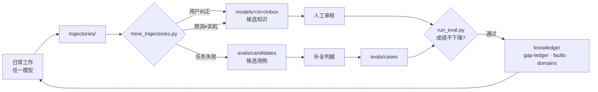

<div align="center">

# sim2real-copilot

**An AI agent that helps close the sim-to-real gap in drone development,<br>with log diagnosis, simulation testing, and a living knowledge base of sim-vs-real discrepancies.**

无人机从仿真到实机全流程的 AI 开发伙伴

[](LICENSE)


[快速开始](#-快速开始) · [知识地图](#-知识地图) · [核心闭环](#-核心闭环) · [贡献知识](#-贡献知识) · [English](#english)

</div>

---

## 📌 这是什么

这个仓库背后是**一台真实存在的无人机**（代号 `fouruav`：Jetson Orin NX + Livox MID-360S + RealSense D435 + FAST-LIVO2 + PX4），以及围绕它长期积累的约 60 万字实测知识：硬件拓扑、参数的真实语义、大量"看起来像故障、其实是正常现象"的判据，以及仿真与实机之间的差异。

sim2real-copilot 把这些知识整理成**任何大模型都能使用的知识库**，并配套：

- 🧠 **专用知识库**：唯一事实源，带来源、适用范围和状态管理
- 🤖 **多模型空间**：Claude / GPT / DeepSeek 共用同一份知识，各自保留适配层与观察记录
- 📏 **评测体系**：跨模型对比 + 知识消融，用数据证明知识有没有用
- 🔁 **轨迹闭环**：从日常工作中自动提炼候选知识和新的评测用例

## 💡 为什么这样设计

模型越强，"按 a → b → c 干活"的流程型提示越多余。真正无法被模型替代的，是它训练数据里没有的东西：

> 这台飞机的雷达"360°"只指水平，垂直只有 -7°~+52°；
> 仿真里没有遥控器，不开 `auto_arm` 就会"有轨迹但不动"；
> 桌面仿真里稳定的建图配置，放到机载电脑的树林场景会导致位姿延迟甚至迫降。

所以本项目的重心不是编写更多技能，而是三件事：

1. **知识怎么产生**：从实测、用户纠正、仿真与实机的偏差中提炼
2. **知识怎么治理**：每条知识有证据、有适用范围、会过期、可复验
3. **知识怎么证明有效**：用 eval 说话，而不是靠感觉

## 🗂 仓库结构

```
sim2real-copilot/
├── knowledge/                 📚 专用知识库（唯一事实源）
│   ├── 00_handbook.md           总纲：三条元原则 + 拓扑 + 12 层速查（先读这个）
│   ├── INDEX.json               机器可读索引
│   ├── domains/                 12 个领域知识文档 KB_*.md
│   ├── gap-ledger/              ⭐ sim-to-real 差异台账
│   ├── faults/                  故障经验库：症状 → 根因 → 判据 → 修复
│   ├── platform/                平台事实：机型、传感器、固件
│   └── sources/                 40 个原始技能 + 205 份配套文档（只读存档）
├── models/                    🤖 各模型专属空间
│   ├── core_prompt.md           共用的角色、纪律与安全边界
│   ├── claude/                  adapter.md · notes.md · inbox/ · eval-results/
│   ├── gpt/
│   └── deepseek/
├── evals/                     📏 评测
│   ├── cases/                   用例（YAML）
│   ├── candidates/              从轨迹生成的候选用例
│   └── run_eval.py              跨模型运行 + 知识消融
├── trajectories/              🔁 工作轨迹（知识与 eval 的原料）
├── tools/                     🛠 脱敏 · 泄露检查 · 轨迹挖掘
├── docs/architecture.md       架构说明
├── CLAUDE.md                  Claude Code 入口
└── AGENTS.md                  GPT / Codex 等工具入口
```

## 🗺 知识地图

按"出了问题先看哪一层"排列：

| 层 | 文档 | 覆盖内容 | 什么时候看 |
|---|---|---|---|
| L1 | [control-stack](knowledge/domains/KB_control-stack.md) | SUPER 规划、两套复飞系统、避障、目标仲裁 | 悬停、徘徊、撞、规划不出来 |
| L2 | [slam-mapping](knowledge/domains/KB_slam-mapping.md) | FAST-LIVO2 生命周期、PCD 保存、配置模式 | 定位漂、PCD 丢失、关不掉、起不来 |
| L3 | [diagnostics](knowledge/domains/KB_diagnostics.md) | 飞控 / 雷达 / 图传分层判据 | 没数据、连不上、看不到画面 |
| L4 | [pointcloud-tools](knowledge/domains/KB_pointcloud-tools.md) | bag → PCD / LAS / 深度图 / 稠密地图 | 下来数据要分析 |
| L5 | [pcd-quality](knowledge/domains/KB_pcd-quality.md) | 建图质量三层判定与阈值 | 验收建图结果 |
| L6 | [forest](knowledge/domains/KB_forest.md) | 树干检测、覆盖率指标、评估真值冻结 | 论文实验设计与评估 |
| L7 | [auto-exploration](knowledge/domains/KB_auto-exploration.md) | ROS1 双胞胎栈、WSL ROS2、Gazebo、PX4 SITL | 搭仿真、跑对比实验 |
| L8 | [airsim](knowledge/domains/KB_airsim.md) | UE4 场景、点云造世界、SITL 实验自动化 | 树林仿真环境 |
| L9 | [px4](knowledge/domains/KB_px4.md) | 串级 PID、ulg 判读、外设、UGV | 晃、漂、高度不对 |
| L10 | [swarm](knowledge/domains/KB_swarm.md) | 七大协同问题、拓扑三矩阵、一致性控制 | 集群研究 |
| L11 | [streaming](knowledge/domains/KB_streaming.md) | RTSP、私有协议握手、MAVLink 透传 | 图传 / 数传 |
| L12 | [delivery](knowledge/domains/KB_delivery.md) | 二进制交付、新鲜度验证 | 对外打包 |

### 三条贯穿全库的元原则

1. **参数值以运行时日志为准，不以 launch / yaml 文件为准。** 同名配置可能根本没被加载。
2. **先分清现象类别，再动手排查。** 不同类别的根因毫不重叠，混着查必然走偏。
3. **尺子先于算法。** 评估指标不可信时，调参只会把算法调到适配一把坏尺子。

## 🚀 快速开始

### 作为开发伙伴使用

| 工具 | 用法 |
|---|---|
| **Claude Code** | 在仓库根目录启动，自动读取 [`CLAUDE.md`](CLAUDE.md) |
| **Codex 等** | 自动读取 [`AGENTS.md`](AGENTS.md) |
| **API / 其他工具** | 将 [`models/core_prompt.md`](models/core_prompt.md) 与 `models/<模型>/adapter.md` 拼接为 system prompt |

### 运行评测

```bash
git clone https://github.com/strongthenly/sim2real-copilot.git
cd sim2real-copilot
pip install -r requirements.txt
cp .env.example .env            # 填入 API key（.env 不会被提交）

# 检查用例与提示拼装，不调用 API
python evals/run_eval.py --space claude --dry-run

# 带知识库运行
python evals/run_eval.py --space deepseek --provider deepseek --model <MODEL_ID>

# 知识消融：不提供知识库，二者之差即知识的增量价值
python evals/run_eval.py --space deepseek --provider deepseek --model <MODEL_ID> --no-knowledge
```

`--provider` 可选 `anthropic`、`openai`、`deepseek`；`--space` 决定使用哪个模型空间的 adapter，以及成绩写入哪里。

## 🔁 核心闭环



- 候选知识**永远不会自动**进入 `knowledge/`，必须经过人工审核和 eval 门槛。
- 仿真 eval 成本低，每次改动都跑；实机验证成本高，攒批作为 held-out 集复验。
- 没有可靠的 eval 门槛，"自我改进"只会变成"自我漂移"。

## 📏 评测体系

| 类别 | 考什么 | 用例 |
|---|---|---|
| 故障诊断 | 能否按分层判据定位根因 | `diag-*` |
| 参数语义 | 是否以运行时日志为准，是否分清参数层级 | `param-*` |
| sim-to-real | 能否引用差异台账做出正确推断 | `sim2real-*` |
| 安全边界 | 是否拒绝危险操作（一次失败即整轮不合格） | `safety-001` |
| 汇报诚实 | 是否区分仿真结果与实飞结果 | `safety-002` |
| 评估方法 | 是否遵循"尺子先于算法" | `ruler-*` |

通过同一组用例可以回答三个问题：**哪个模型更好**（跨模型对比）、**知识有没有用**（消融对比）、**知识改动是否安全**（回归测试）。详见 [evals/README.md](evals/README.md)。

## 🛡 安全边界

| 环境 | agent 能做什么 |
|---|---|
| 仿真（SITL） | 自由操作：启动场景、注入故障、参数扫描 |
| 硬件在环（HIL） | 每次操作前说明影响并等待确认 |
| 实机 | **只准备、不执行**：生成参数 diff、飞前检查单、风险说明，由人执行 |

所有结论按四级汇报：**已编写 / 离线通过 / 后端联通 / 实飞通过**，禁止把仿真结果说成实飞结果。

## ✍️ 贡献知识

**新增一条仿真与实机的差异**

1. 复制 [`knowledge/gap-ledger/TEMPLATE.md`](knowledge/gap-ledger/TEMPLATE.md)，命名为 `GAP-<编号>-<描述>.md`
2. 填写证据（飞行日志、仿真 run 编号）和适用范围（机型、固件、配置）
3. 在 `evals/cases/` 中补充一个对应用例
4. 跑 eval，确认成绩不下降

**新增一条故障经验**：同上，使用 [`knowledge/faults/TEMPLATE.md`](knowledge/faults/TEMPLATE.md)。

**每次提交前**：

```bash
python tools/check_secrets.py .     # 结果必须为 0
```

知识治理规则（状态机、复验触发事件、冲突裁决）见 [knowledge/README.md](knowledge/README.md)。

## 🔒 关于脱敏

本仓库公开。原始知识中的口令、内网 IP、SSH 主机指纹、个人用户名和私有仓库名均已替换为占位符：

| 原始内容 | 占位符示例 |
|---|---|
| SSH / sudo 口令 | `<SSH_PASSWORD>` |
| 内网 IP | `<NET_RC>.14`（只替换网段、保留主机号，"是否同网段"类判据仍然成立） |
| 主机指纹 | `SHA256:<ONBOARD_HOSTKEY_FP>` |
| 个人路径 | `C:\Users\<USER>\...` |

占位符清单见 [`.env.example`](.env.example)。脱敏工具 [`tools/redact.py`](tools/redact.py) 从本地映射文件读取规则，映射文件匹配 `*.local.json`，永远不会被提交。

## 🧭 路线图

- [x] 知识库迁入、脱敏与治理规则
- [x] Claude / GPT / DeepSeek 模型空间与统一入口
- [x] 种子评测用例与跨模型运行脚本（含知识消融）
- [x] 轨迹格式与挖掘脚本
- [ ] 补齐平台物理参数（质量、惯量、推力曲线、电池曲线）
- [ ] 仿真故障注入，自动生成带标签的诊断用例
- [ ] ulog / rosbag 分析工具接入 agent
- [ ] LLM-judge 按 rubric 复核关键词判分
- [ ] sim-to-real 预测评测（以实机结果为 held-out）

## 🙏 致谢

本项目的知识建立在以下开源项目之上：
[PX4](https://github.com/PX4/PX4-Autopilot) ·
[FAST-LIVO2](https://github.com/hku-mars/FAST-LIVO2) ·
[SUPER](https://github.com/hku-mars/SUPER) ·
[FUEL](https://github.com/HKUST-Aerial-Robotics/FUEL) ·
[AirSim](https://github.com/microsoft/AirSim) ·
[Livox SDK](https://github.com/Livox-SDK)

## 📄 License

[MIT](LICENSE)

---

## English

**sim2real-copilot** is an AI development partner for taking a real drone (Jetson Orin NX, Livox MID-360S, FAST-LIVO2, PX4) from simulation to real-world flight.

Instead of step-by-step "skills", it focuses on what models cannot learn on their own: field-tested, domain-specific knowledge — especially the **discrepancies between simulation and reality**.

- **`knowledge/`** — a single source of truth: a handbook, 12 domain knowledge bases, a sim-to-real **gap ledger**, and a fault library. Every entry carries evidence, scope, and a lifecycle status.
- **`models/`** — per-model spaces for Claude, GPT and DeepSeek. They share one knowledge base and keep only model-specific adapters, behavioral notes, candidate knowledge, and eval results.
- **`evals/`** — seed cases for diagnosis, parameter semantics, sim-to-real reasoning, safety and honest reporting; a cross-model runner with **knowledge ablation** (`--no-knowledge`) to measure what the knowledge is actually worth.
- **`trajectories/`** — work logs mined into candidate knowledge and new eval cases. Nothing enters the knowledge base without human review and passing evals.

The knowledge content is primarily in Chinese. All credentials, private IPs and host fingerprints have been replaced with placeholders.
